# 智能旅行助手

说一句去哪儿、几天、多少预算，出一份逐天的行程：每天去哪几个景点、住哪家酒店、怎么走、
花多少钱。方案出来之后还能**接着追问**（「第二天为什么排这家酒店」），
判出你想改的时候帮你改（「第二天住得离西湖近一点」）——但改不改由你点确认，它自己不擅自动手。

跨会话记得住你：不吃辣、同行的人对海鲜过敏、上次在杭州住的那家隔音差，
下一次规划会自动带上，冲突时会当面指出来而不是顺着方案说「这家不错」。

> 下面每个功能都配了实拍图，都是真跑出来的：上海 → 北京 3 天，接真模型与高德底图。
> 全部产品图在 [`docs/images/`](docs/images/)，压成 webp 一共 150 KB 不到。

## 功能

### 账号

注册 / 登录 / 登出。密码 bcrypt，会话 cookie `httponly` + `samesite=lax`。
长期记忆按 `user_id` 存，一个库装所有客户。

| 登录 | 注册 |
| --- | --- |
| 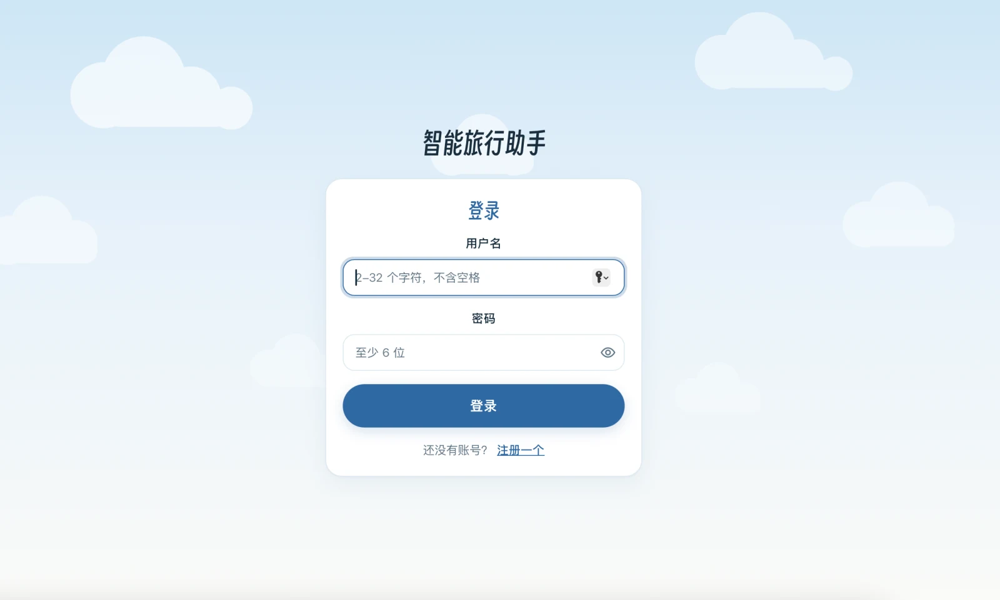 |  |

### 规划

景点 / 天气 / 酒店 / 路线四路数据，配了模型时由 `create_agent` 自主选工具取，
没配模型自动退回固定顺序取数 + 规则兜底文案，**不配模型也能出完整行程**。
出方案后走「生成 → 反思评分 → 批评 → 修正 → 再生成」的多轮闭环选最优。

走一遍是五步。

**① 填委托单**　只有住宿位置可留空。「住宿连续性」那格管的是三天住同一家、还是每天重新挑。

| 行程：城市、日期 | 偏好：预算、交通、住宿、偏好标签、备注 |
| --- | --- |
| 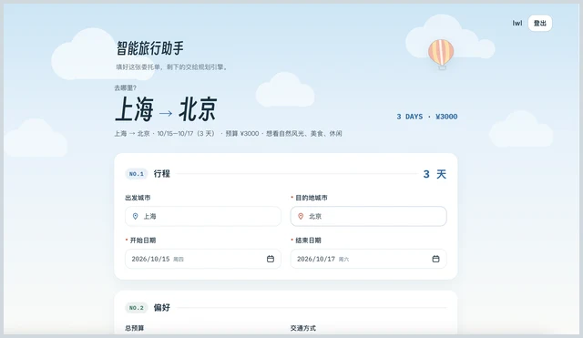 | 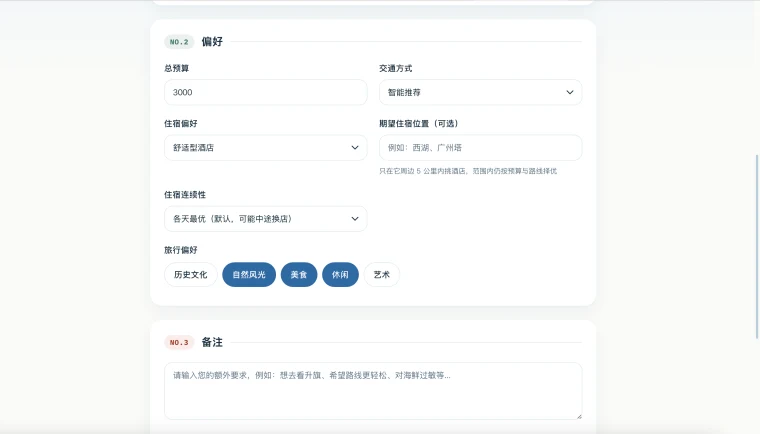 |

**② 提交，等它跑**　约 30 秒。SSE 把「景点 → 天气 → 酒店 → 路线 → 生成 → 反思」推到进度条上。

<p align="center">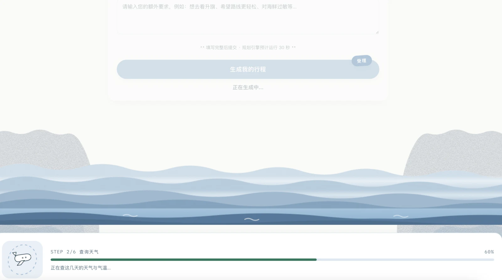</p>

**③ 先看总览**　摘要、徽章、预算结余、通勤规模。摘要那段是模型写的，不是模板拼的。

<p align="center">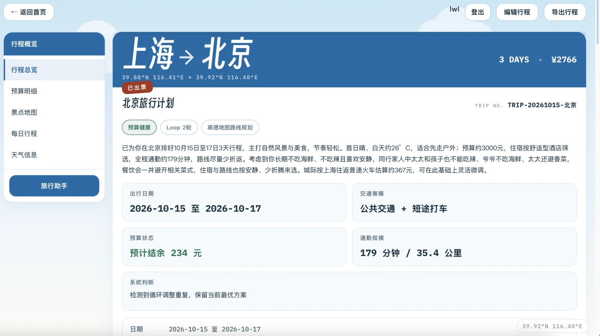</p>

**④ 看钱花在哪**　每一格都写着自己怎么估出来的。同一屏右边是真底图，「住」那个图钉就是住宿锚点。

<p align="center">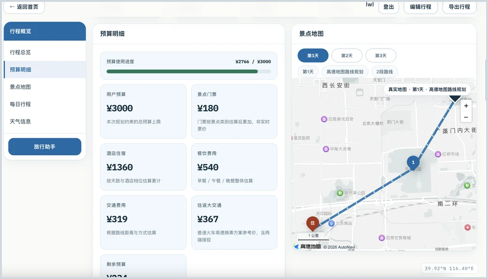</p>

**⑤ 最后翻每天**　每天一条时间轴、一段路线、三餐。最下面是这一轮的调整说明——反思提了什么、最后为什么这么定。

<p align="center">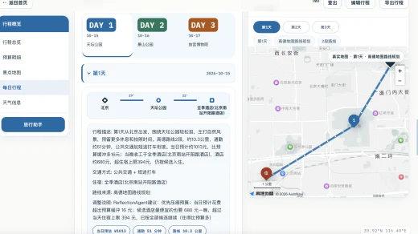</p>

<details>
<summary>更多规划截图：第 2 天、当日路线分段与三餐</summary>

**第 2 天**：按反思意见减掉了故宫

<p align="center">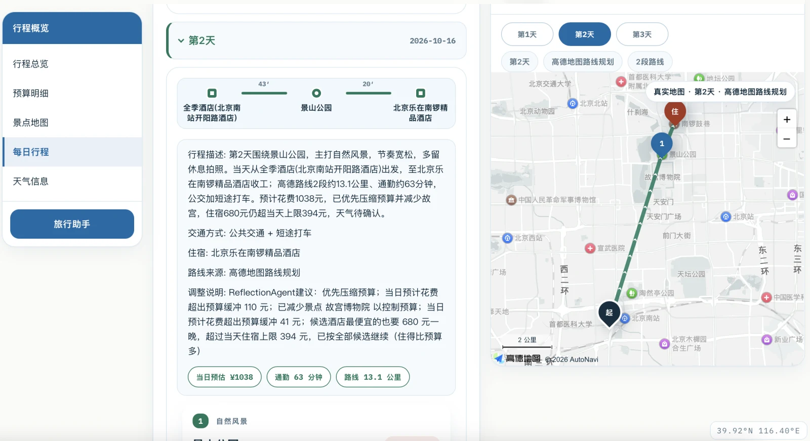</p>

**路线分段（高德）与三餐**

<p align="center">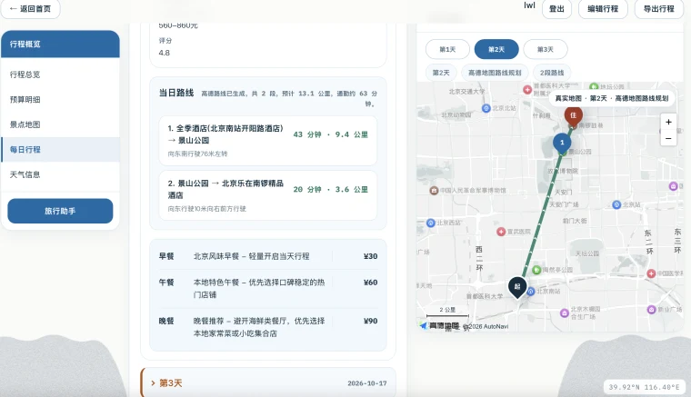</p>

</details>

### 追问

六个只读工具（方案总览 / 某天安排 / 景点详情 / 搜景点 / 查天气 / 荐酒店），
答不上就说答不上，不编。联网失败不整体失败，改用方案内数据作答并留一条 `failed` 留痕。
SSE 推工具调用当进度条。说到新偏好会**顺手记下**，答案下面回一行「已记住」：

<p align="center">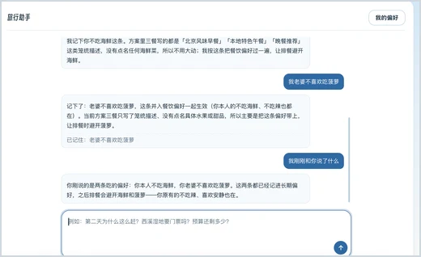</p>

### 改方案

「第二天住得离西湖近一点」这类，追问时判出是改方案的诉求，
但**它不擅自动手**。两步：

**① 先给确认卡**　把改动翻成人话——「住宿位置：天安门（第 2 天）」。点「算了」就当没说过。

<p align="center">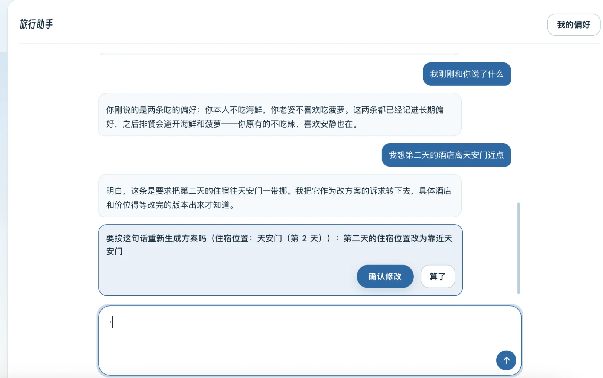</p>

**② 点了才重算**　重算期间盖一层进度弹窗，不会偷偷改完再告诉你。

<p align="center">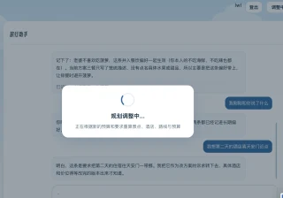</p>

### 长期记忆

两桶互斥：

- **偏好**——「不吃辣」记给本人，「老婆不吃辣」记给老婆，去重键是 `(用户, 角色, 内容)`，
  同一条内容两个角色各存一条
- **场景**——「上次杭州那家酒店隔音差」按城市存，**只在目的地是杭州时**才注入

注入提示词时明写两条规矩：本次说的优先、冲突要说出来。空的时候整段不拼，
不塞一句「暂无长期记忆」提醒模型这里本来该有点什么。

上面「行程总览」那张里，摘要那段是**模型自己写的**：它主动写出了
「太太和孩子也不能吃辣、爷爷不吃海鲜、太太还避香菜」——偏好不是躺在库里，
是真进了提示词、真改了输出。记了哪些、要删哪条，点旅行助手右上角的「我的偏好」：

<p align="center">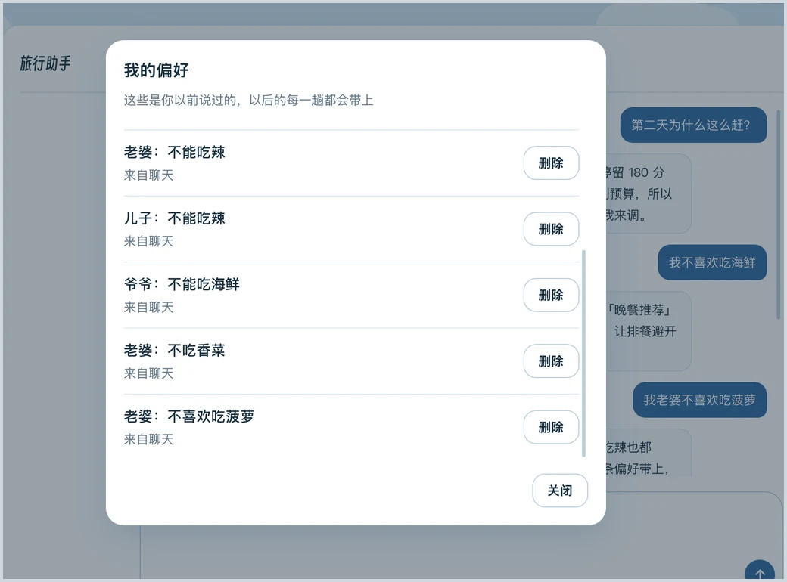</p>

## 快速开始

### 1. 安装

```bash
uv venv .venv
uv pip install -p .venv/bin/python --index-url https://mirrors.aliyun.com/pypi/simple/ -r requirements.txt
```

直连 pypi 超时时用上面的阿里云镜像；已有 `.venv` 可跳过第一行。

### 2. 配置

```bash
cp .env.example .env   # 然后填 TRAVEL_LLM_API_KEY 与 AMAP_API_KEY
```

配置项来自环境变量或本地 `.env`，**不要**把 key 写进代码、README 或提交信息（`.env` 也别提交）。
`TRAVEL_LLM_API_KEY` 不填时会回退读 `DASHSCOPE_API_KEY`。
模型端点默认是 DashScope 的 OpenAI-Compatible 地址 + `qwen-plus`，
但走的是通用 OpenAI 协议：把 `TRAVEL_LLM_BASE_URL` / `TRAVEL_LLM_MODEL` 换成任意
OpenAI-Compatible 端点即可，本机实测用 DeepSeek 端点跑通全链路。

要出真实地图再填 `AMAP_WEB_JS_KEY` / `AMAP_SECURITY_JS_CODE`（必须是「Web端(JS API)」类型，
与后端那把「Web服务」key 不通用）；不填时地图区显示占位提示。

<details>
<summary>全部配置项</summary>

| 环境变量 | 默认值 |
| --- | --- |
| `TRAVEL_LLM_ENABLED` | `false`（置 `true` 才走模型自选工具，否则按固定顺序纯规则取数） |
| `TRAVEL_LLM_BASE_URL` | `https://dashscope.aliyuncs.com/compatible-mode/v1` |
| `TRAVEL_LLM_API_KEY` / `DASHSCOPE_API_KEY` | 空 |
| `TRAVEL_LLM_MODEL` | `qwen-plus` |
| `TRAVEL_LLM_TEMPERATURE` | `0.2` |
| `TRAVEL_PROVIDERS_ATTRACTION/WEATHER/HOTEL/ROUTE` | `amap` |
| `AMAP_API_KEY` | 空 |
| `AMAP_BASE_URL` | `http://restapi.amap.com` |
| `AMAP_MOCK_RESPONSE` | `false` |
| `AMAP_ROUTE_STRATEGY` / `AMAP_ROUTE_EXTENSIONS` | `0` / `base` |
| `AMAP_CURL_FALLBACK_ENABLED` | `true` |
| `AMAP_POI_PAGE_SIZE` / `AMAP_CITY_LIMIT` | `10` / `true` |
| `AMAP_WEB_JS_KEY` / `AMAP_SECURITY_JS_CODE` | 空。只被 `GET /api/map/config` 读 |
| `TRAVEL_LOOP_ENABLED` | `true` |
| `TRAVEL_LOOP_MAX_ROUNDS` | `3` |
| `TRAVEL_LOOP_MAX_NO_IMPROVEMENT_ROUNDS` | `2` |
| `TRAVEL_DB_DSN` | `postgresql:///travel_assistant`，本地 socket、无密码 |
| `SERVER_PORT` | `8080` |

**兜底开关的两层语义**：

1. `TRAVEL_PROVIDERS_<SOURCE>=amap` 走高德实现，其他任意值走规则/本地兜底实现（大小写不敏感）。
2. 选中高德后：`AMAP_MOCK_RESPONSE=true` 直接返回兜底实现的数据；未配 `AMAP_API_KEY` 抛
   "已选择高德X provider，但尚未配置 AMAP_API_KEY"；请求失败或结果为空时按各自源的规则
   兜底（酒店/天气/路线回退规则实现，景点回退本地知识库，POI/天气缺某天用规则补全，
   路线限流自动切规则估算）。景点/酒店的兜底是静默的，只在 summary 与 `provider` 字段里体现来源。

</details>

### 3. 数据库

登录与长期记忆要 Postgres。建库：

```bash
createdb travel_assistant
```

建表语句在 `travel_assistant/schema.sql`，由 `db.get_pool()` 在第一次用到数据库时**幂等执行**，
不上 alembic。连接串用 `TRAVEL_DB_DSN` 覆盖。

> `create table if not exists` 对**已存在的表整条跳过**，所以改列它一个字都不会做。
> 升级已有库要跑 `schema.sql` 里那几行 `alter table`（文件内有注释说明）。

`data/chroma/` 是景点知识库的向量索引，**不入库**。它由 `scripts/kb/` 下的建库工具按城市生成；
缺了它景点检索退回内置词表，不影响启动。

### 4. 启动

```bash
PYTHONPATH=. .venv/bin/python -m travel_assistant.main
# 或者：.venv/bin/python -m uvicorn travel_assistant.main:app --host 0.0.0.0 --port 8080
```

启动日志只打印 provider、base-url 和开关，**不打印 key**。
起服务后浏览器打开 `http://localhost:8080/` 就是前端页面，未登录会落到登录页。

## 接口

| 端点 | 说明 |
| --- | --- |
| `POST /api/auth/register` `login` `logout`、`GET /api/auth/me` | 注册 / 登录 / 登出 / 当前用户 |
| `POST /api/trips/plan` | 生成行程 |
| `POST /api/trips/adjust` | 用自然语言改计划 |
| `POST /api/trips/ask` | 就当前方案追问 |
| `POST /api/trips/ask/stream` | 同上，SSE 推工具调用 |
| `GET /api/preferences` | 列出已记住的偏好 |
| `DELETE /api/preferences/{id}` | 删一条 |
| `GET /api/map/config` | 前端地图配置（唯一不要求登录的端点） |

除 `/api/map/config` 外都要求登录。字段名用驼峰风格，
错误体统一是 `{code, message, details[], timestamp}`。

**请求 / 响应字段、curl 示例、各端点行为细节见 [`docs/API.md`](docs/API.md)。**

## 项目结构

```
travel_assistant/
  main.py             FastAPI 装配 + CORS + StaticFiles 挂载 + 启动
  db.py schema.sql    Postgres 连接池 + 建表（幂等执行）
  api/                auth / trip / ask / map 四个 controller + 鉴权依赖 + 错误处理
  config/             settings（配置项）/ container（依赖注入）/ runtime_logger
  models/             pydantic 模型，字段名对外保持驼峰
  clients/            高德四源 + 规则兜底 + selector + LLM
                      + 用户库三个 store（auth / preference / episode）
  kb/                 景点知识库：编码、检索、词表
  agent/              四路数据 agent + planner + loop 闭环 + trip_adjustment
                      + ask_agent / ask_tools / ask_context（追问）
  evaluator/          budget / route / weather / daily_plan
  service/            planner_input_builder / requirement_analysis / trip_planning
                      / auth / preference / episode / hotel_anchor / intercity …
  static/             index.html + css/ + js/ + 字体 + 插画（FastAPI 挂在根路径）
tests/                529 条，见下
docs/                 设计稿与验收记录，见下；images/ 是 README 用的产品图
scripts/              建库工具、视觉验收探针、结果页渲染
data/                 景点资料、标签表；chroma/ 是本地生成的索引，不入库
```

## 测试

```bash
.venv/bin/python -m pytest -q      # 529 passed
```

全部是单元测试——喂死数据，**不调模型、不碰数据库**。真 SQL（unique 约束、`on conflict do nothing`）
由 `test_*_store_postgres.py` 三个文件单独守，它们要一个真的库。

端到端验收另有一套探针：起真服务、连真库、调真模型，跑一次几分钟。**探针随仓库走**，
在 `scripts/preference_probe.py`（长期记忆那几档的判据都在它里面），
从仓库根跑：`.venv/bin/python scripts/preference_probe.py`。
两层的分工是：单元测试证明**每个函数按写的做**，探针证明**整条链真的接通了**——
后者能抓到前者抓不到的（HTTP 那条路上 `user_id` 有没有传到底、真库认不认那个唯一键、
删掉之后是不是真的不再进提示词）。

## 设计文档

`docs/` 下是各功能的设计稿与逐条验收记录，**改代码前先看这里**：

| 文档 | 内容 |
| --- | --- |
| [`docs/ASK_LONGTERM_MEMORY.md`](docs/ASK_LONGTERM_MEMORY.md) | 登录、长期偏好、场景记忆（分档设计 + 判据 + 实机验收） |
| [`docs/ASK_AGENT_DESIGN.md`](docs/ASK_AGENT_DESIGN.md) | 方案追问：工具、护栏、意图判定 |
| [`docs/ADJUST_AGENT_DESIGN.md`](docs/ADJUST_AGENT_DESIGN.md) | 追问驱动改方案 |
| [`docs/API.md`](docs/API.md) | 接口参考 |
| [`docs/DESIGN_NOTES.md`](docs/DESIGN_NOTES.md) | 行为口径、设计取舍、验收记录 |
